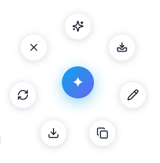
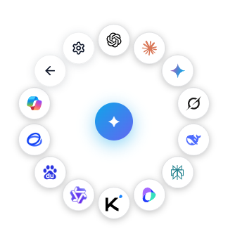

<div align="center">


# OrbitShot

**截图 → 标注 → 环形菜单 → 一键发送到网页版 AI**

Visual Context Router · Chrome Extension (Manifest V3)

</div>

---

## 这是什么

OrbitShot 是一款浏览器截图扩展：截取屏幕任意区域，快速标注，然后通过一个**环形辐射菜单**把截图直接发送到你常用的网页版 AI（ChatGPT、Claude、Gemini、Grok、DeepSeek、Kimi 等 20+ 内置入口）。

不再需要：手动保存图片 → 打开 AI 网站 → 点上传按钮 → 选文件。截图完成，一次点击，图片自动出现在 AI 对话输入框中。

## ✨ 核心特性

- **🎯 区域 / 整页截图**：框选任意区域或捕获整个页面，支持自定义快捷键与右键菜单触发
- **✏️ 完整标注编辑器**：箭头、矩形、椭圆、画笔、文字（多行）、高亮、马赛克、橡皮擦；支持选中、拖动、8 向缩放、双击改字、撤销重做
- **🎡 两级环形菜单**：一级操作（标注 / 复制 / 下载 / 暂存），二级 AI 列表按住设置动态生成，均匀圆周布局
- **📥 截图暂存工作台**：连续截图不打断流程，集中预览、排序、多选、重标注，再统一分发
- **🤖 自动注入**：截图自动粘贴进目标 AI 的对话输入框（逐站点适配器 + 通用回退），多图按顺序注入并验证
- **🚀 批量分发**：同一组截图一键发送给多个 AI，各平台任务状态独立展示、支持单独重试
- **🌍 三语界面**：简体中文 / 繁體中文 / English

## 🖼️ 界面预览

**一级环形菜单**（标注 / 复制 / 下载 / 暂存等快捷操作）：



**二级 AI 菜单**（按设置中启用的平台动态生成，均匀分布）：



## 📦 安装使用

1. 下载本项目并安装依赖：

   ```bash
   npm install
   npm run build
   ```

2. 打开 Chrome，进入 `chrome://extensions`，开启右上角「开发者模式」
3. 点击「加载已解压的扩展程序」，选择本项目的 **`dist`** 目录
4. 点击扩展图标或按 `Alt+Shift+S` 开始截图；截图后通过环形菜单发送或暂存

> 默认快捷键：`Alt+Shift+S` 区域截图，`Alt+Shift+O` 打开暂存区 —— 均可在设置页自定义。

## 🛠️ 技术栈

Vite · React · TypeScript · Tailwind CSS · CRXJS · Chrome MV3 (Service Worker / IndexedDB / Scripting)

## 📄 License

MIT

---

学AI，上 [L站](https://linux.do/)
